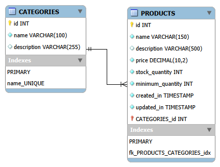

# Organiza Comercial — API de produtos e estoque

## Tecnologias
- Node.js
- Express
- MySQL

## Bibliotecas
- dotenv
- mysql2

## DER


## Como executar
1. Execute `database/script.sql` no MySQL Worckbench;
2. Abra um terminal na pasta do projeto e execute:
```powershell
npm init -y
```
3. Depois execute:
```powershell
npm install node nodemon express dotenv mysql2
```
4. Copie `.env.example` para `.env` e ajuste usuário, senha e demais configurações;
5. Execute `npm run dev` para desenvolvimento ou `npm start` para execução normal;
6. A API ficará disponível em `http://localhost:3033`.

Não compartilhe o arquivo `.env` nem inclua credenciais reais no repositório.

### Rotas
Base: `/products`

| Método | Rota | Descrição |
|--- |--- |--- |
| GET | `/products` | Lista produtos |
| GET | `/products?categoryId=1` | Filtra por categoria |
| GET | `/products?status=baixo` | Filtra por situação: `normal_stock`, `low_stock` ou `out_of_stock` |
| GET | `/products/:id` | Consulta um produto |
| POST | `/products` | Cadastra um produto |
| PUT | `/products/:id` | Atualização completa |
| PATCH | `/products/:id` | Atualização parcial |
| DELETE | `/products/:id` | Exclui um produto |

Os filtros por categoria e situação são independentes. Envie apenas um deles por requisição.

#### Exemplo de corpo para POST/PUT
```json
{
  "name": "Teclado USB",
  "description": "Teclado padrão ABNT2",
  "price": 79.9,
  "stockQuantity": 10,
  "minimumQuantity": 3,
  "categoryId": 4
}
```

Para atualização parcial, envie somente os campos a alterar. Um campo não enviado permanece inalterado. Campos enviados são validados.